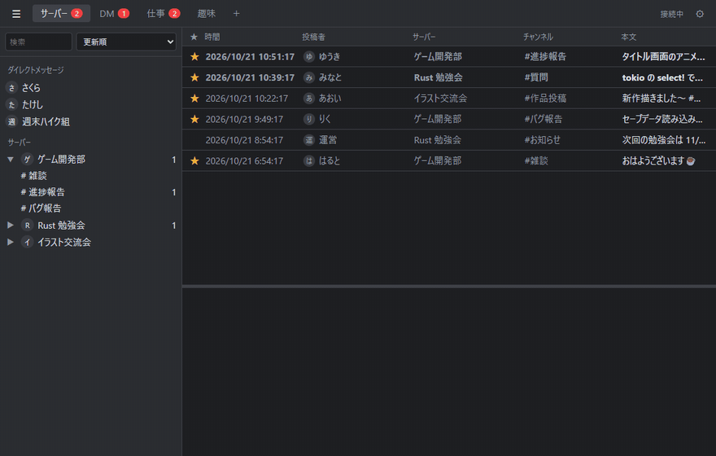
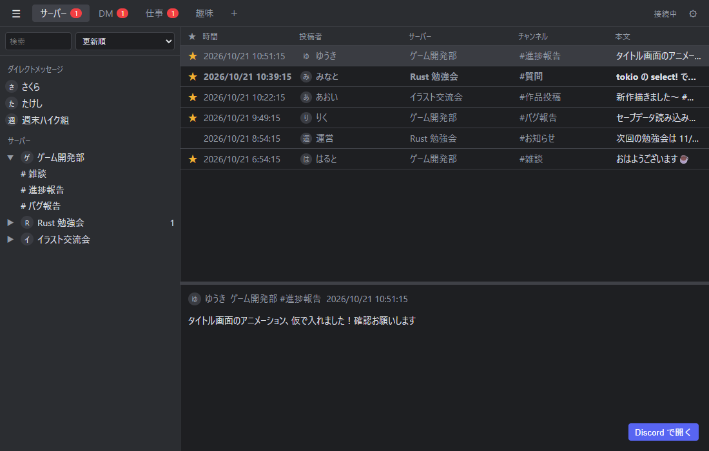

# DashTray

Discord のメッセージをタスクトレイから確認できる Windows 用 Tauri アプリ（Discord RPC + OAuth2 PKCE）。





## 機能

### トレイ（タブ）で新着を仕分け
- サーバー・チャンネル・DM に ★ を付けると、そのトレイに新着が集まる（「仕事」「趣味」など用途別に作れる）
- トレイの追加・複製・名前変更（ダブルクリック）・ドラッグで並べ替え・非表示
- 受信トレイ：★ なしで全部受け取る。「サーバーと DM をまとめる／分ける／サーバーのみ／DM のみ」から選べる
- 新着はサーバーごと、またはチャンネルごとに最新 1 件へまとめて表示

### 通知
- 未読数をタブにバッジ表示、タスクトレイのアイコンにも赤い点
- トレイごとにトースト通知・通知音（6 種類）・バッジを切り替え
- 同じチャンネルの通知音を一定秒数鳴らさない設定

### 一覧と本文
- 時間・投稿者・サーバー・チャンネル・本文の列表示。列の表示切り替えと幅の変更ができる
- 下のプレビュー欄で本文を表示（境目はドラッグで調整）
- ダブルクリックや「Discord で開く」でそのメッセージへ移動
- 右クリックで既読／未読、メッセージのリンク（https / discord://）・ID・本文のコピー、トレイへの追加

### サイドバー
- DM とサーバー・チャンネルの一覧。検索、更新順／名前順の並べ替え、★ のみ表示
- DM はチャンネル ID を貼り付けて追加できる

### 常駐
- Windows 起動時に自動起動（最小化してトレイに常駐）
- 止まっていた間の新着を起動時に取り込む
- 常に前面に表示

## 動作環境

- Windows 10 / 11
- Discord デスクトップアプリが起動していること（Discord RPC で接続します）
- 初回起動時に Discord の画面で連携を許可します
- 設定と既読状態は `%APPDATA%\app.discordmailer` に保存されます

### 制限
- Discord 本体で読んだメッセージも DashTray では未読のまま（RPC では既読状態を取得できないため）
- Discord RPC は Discord 側でベータ扱いのため、アプリのオーナーやテスターとして登録されたアカウントでないと連携できない場合があります

## ビルド

```
npm install
npm run build:portable   # dist/DashTray.exe と dist/DashTray.zip
```

## License

MIT
