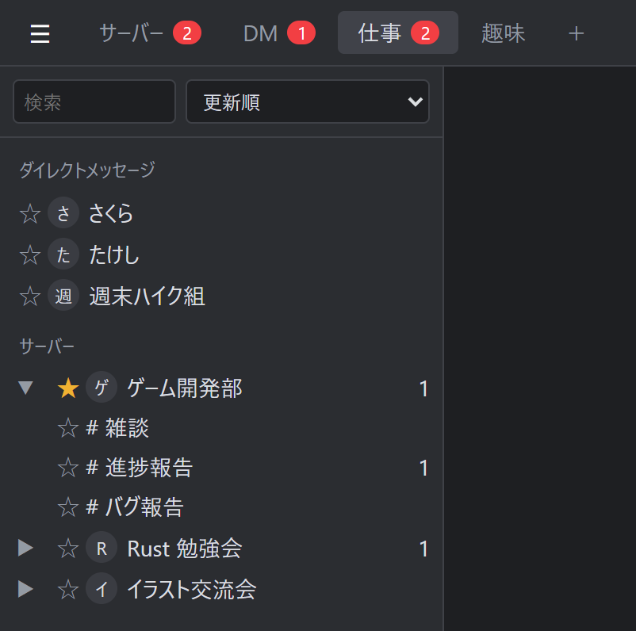
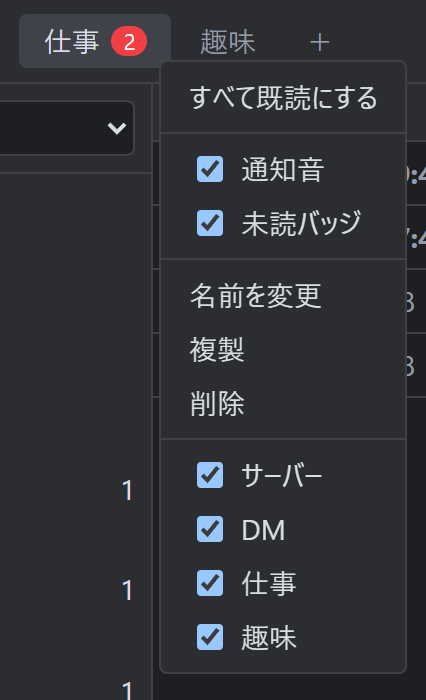
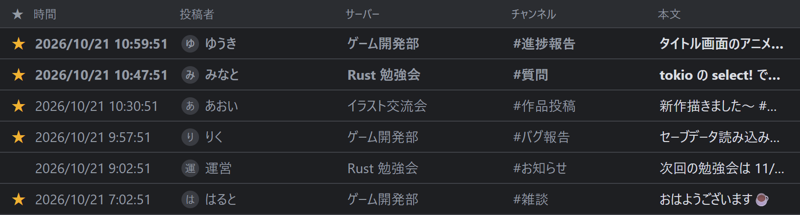
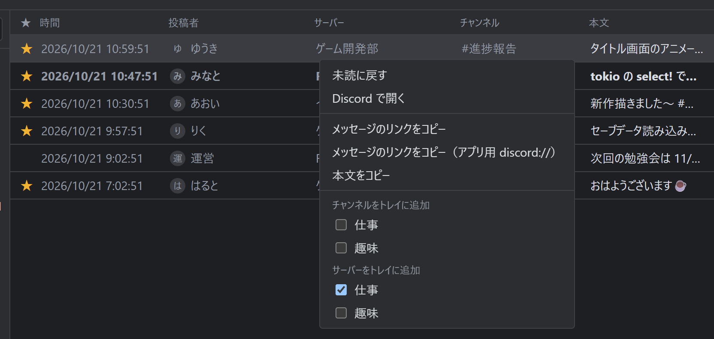
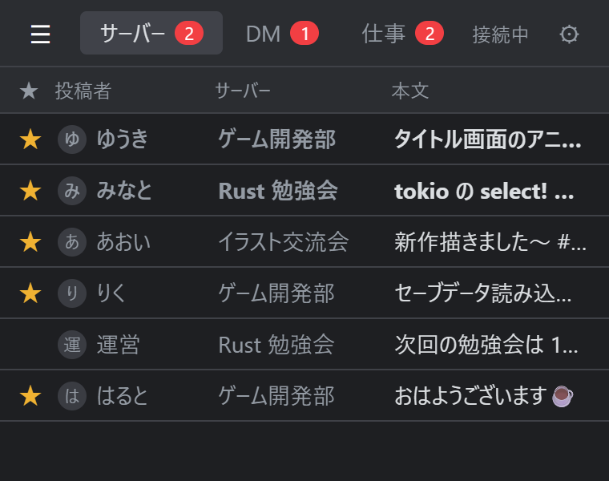

# DashTray

Discord のメッセージをタスクトレイから確認できる Windows 用 Tauri アプリ（Discord RPC + OAuth2 PKCE）。


## こんなときに

### サーバーが多すぎて、大事な発言を見落とす
参加しているサーバーが増えると、Discord の赤いバッジはいつも点きっぱなしで、本当に読むべき発言が埋もれてしまいます。
DashTray では、気になるサーバー・チャンネル・DM に ★ を付けるだけで、その新着が 1 つのトレイに集まります。「仕事」「趣味」のようにトレイを分けておけば、今は仕事の連絡だけ、と切り替えて見られます。何も選ばずに全部受け取る受信トレイもあります。



### 作業に集中したいけど、呼ばれたらすぐ気づきたい
Discord を開きっぱなしにすると、つい雑談を追ってしまう。閉じると大事な連絡に気づかない。
DashTray はタスクトレイに常駐し、トレイごとに通知の仕方を決められます。仕事のトレイだけ通知音で知らせ、趣味のトレイは静かに未読を溜めておく、といった使い分けができます。会話が盛り上がっても、同じチャンネルの通知音は一定時間鳴らないので、通知音が鳴りっぱなしになりません。



### 朝 PC をつけたら、夜の間の連絡をまとめて確認
Windows の起動と一緒に裏で立ち上がり、止まっていた間に届いたメッセージを取り込みます。朝はメールの受信箱のように、未読を上から順に読んでいくだけ。発言はチャンネルごと（またはサーバーごと）の最新 1 件にまとまるので、一覧が長くなりすぎません。



### 気になった 1 件だけ Discord で開く
一覧で選ぶと下に本文が出るので、ほとんどは DashTray の中で読み終わります。返事をしたいものだけ、ダブルクリックで Discord のそのメッセージへ飛べます。右クリックでメッセージのリンクをコピーできるので、タスク管理ツールやメモに貼って「あとでやる」にもできます。



### 画面の隅に小さく置いておく
サイドバーは左上の ☰ で、本文のプレビュー欄は右クリック（または ⚙ の設定）で隠せます。一覧の列も右クリックで必要なものだけに絞れ、幅はドラッグで変えられるので、新着の一覧だけを小さなウィンドウで表示できます。「常に前面に表示」と組み合わせれば、作業中のアプリの横に置いて、未読が増えたらひと目で分かります。



## 動作環境

- Windows 10 / 11
- Discord デスクトップアプリが起動していること（Discord RPC で接続します）
- 初回起動時に Discord の画面で連携を許可します
- 設定と既読状態は `%APPDATA%\app.discordmailer` に保存されます


## セキュリティとプライバシー

- **作者のサーバーはありません。** 通信先は、PC 内で動いている Discord アプリ（名前付きパイプ）、ログイン用の `discord.com`、アイコン画像の `cdn.discordapp.com` だけです。利用状況の収集（テレメトリ）もしていません。
- **読むだけで、送信はできません。** Discord に求める権限は `rpc`・`messages.read`・`rpc.notifications.read` だけで、使う命令もサーバー・チャンネル一覧の取得、新着の購読、チャンネルの最新メッセージの取得に限られます。メッセージの送信や削除、設定の変更をする機能はありません。
- **Client Secret を持っていません。** ログインは PKCE 方式なので、exe から秘密の鍵を取り出される心配がありません。
- **偽の Discord には接続しません。** 接続先のプロセスが本物の Discord かを確かめてから、ログイン情報を渡します。
- **ログイン情報は暗号化して保存します。** トークンは Windows の DPAPI で暗号化しており、ほかのユーザーや別の PC に `state.json` をコピーしても読めません（同じユーザーとして動くソフトからは守れない点は、ほかの Windows アプリと同じです）。
- **メッセージ本文はテキストとして表示します。** HTML として解釈しないので、本文に仕込まれたスクリプトは動きません。
- **管理者権限は不要です。** 自動起動も、今のユーザーの権限だけで動くタスクとして登録します。
- v1.0.1 以降の [Releases](https://github.com/Tomozow/DashTray/releases) の exe は、このリポジトリのソースから GitHub Actions でビルドしています。ダウンロードしたファイルが本当にそうして作られたものかは、GitHub CLI で確かめられます。

```
gh attestation verify DashTray.zip --repo Tomozow/DashTray
```

Release ノートに載せた SHA-256 と、手元のファイルのハッシュを比べることもできます（PowerShell）。

```
Get-FileHash DashTray.zip -Algorithm SHA256
```

## ビルド

```
npm install
npm run build:portable   # dist/DashTray.exe と dist/DashTray.zip
```

## License

MIT
