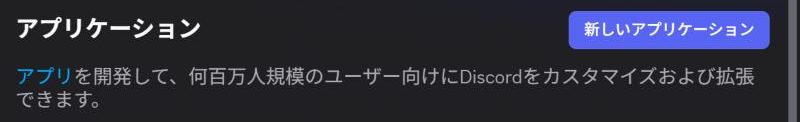
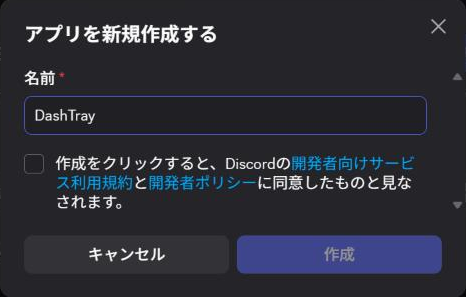
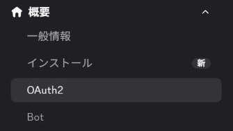
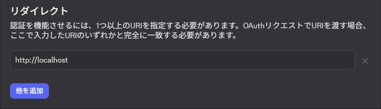
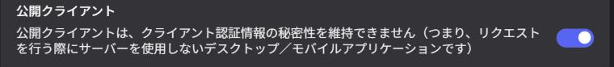
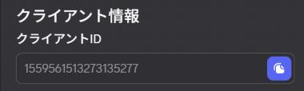
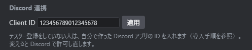

# DashTray 導入手順

## 始める前に

- Windows 10 / 11 で、Discord デスクトップアプリ（ブラウザ版ではなく）を使っていること
- **自分用の Discord アプリを作ってください（5 分ほど・無料）。** DashTray が使う Discord RPC は Discord 側でまだ限定公開の機能で、アプリの持ち主かテスターとして登録された人しか連携できません。自分でアプリを作れば持ち主になるので、すぐに使えます。手順は下の「[自分の Discord アプリを作る](#自分の-discord-アプリを作る)」にあります。

アプリを作らずに使う方法（作者にテスター登録してもらう）

作者に **Discord のユーザー名** を伝えてテスターに登録してもらい、届いた招待を承認すれば、アプリを作らずに使えます。作者が登録するまで待つ必要があり、登録できるのは全体で 50 人までです。この場合、以下の手順の「Client ID の設定」は不要です（空欄のまま）。

## 1. ダウンロード

[Releases](https://github.com/Tomozow/DashTray/releases/latest) から `DashTray.zip` をダウンロードします。

改ざんされていないか確かめたい場合は、README の「[配布物の検証](../README.md#配布物の検証)」を参照してください。

## 2. 展開して置く

zip を右クリック →「すべて展開」し、出てきた `DashTray.exe` を好きなフォルダーに置きます（例: `C:\Users\<ユーザー名>\Apps\DashTray`）。

インストーラーはありません。exe 1 つで動きます。設定と既読状態は `%APPDATA%\app.discordmailer` に保存されるので、exe を別のフォルダーへ移しても引き継がれます。

## 3. 起動する

1. Discord デスクトップアプリを起動しておく
2. `DashTray.exe` をダブルクリック
3. 「Windows によって PC が保護されました」と出たら、「詳細情報」→「実行」を押す
   （exe にコード署名をしていないため表示されます）

## 4. Discord で連携を許可する

**先に Client ID を設定します：** 「[自分の Discord アプリを作る](#自分の-discord-アプリを作る)」の 8 のとおり、DashTray の ⚙（設定）→「Discord 連携」の **Client ID** に、自分のアプリの Client ID を貼り付けて「適用」を押してください。起動直後に Discord で `invalid_scope` のエラーが出ていても、適用すればやり直します（テスター登録の人は空欄のまま）。

初回は Discord の画面に DashTray の許可を求める画面が出ます。内容を確認して「認証」を押してください。

DashTray のウィンドウ下部の表示が「接続中 (ユーザー名)」になれば完了です。サーバーとチャンネルの読み込みが終わると、左のサイドバーに一覧が出ます。

許可するのは初回だけです。次回からは自動で接続します。

## 自分の Discord アプリを作る

Discord アカウントがあれば無料で作れます。画面は日本語表示のものです。

**1.** https://discord.com/developers/applications を開き、普段の Discord アカウントでログインして「**新しいアプリケーション**」を押します。

**2.** 「名前」に好きな名前（例: `DashTray`）を入れ、利用規約のチェックを付けて「**作成**」を押します。

**3.** 作ったアプリの画面で、左のメニューの「**OAuth2**」を開きます（ウィンドウが狭いときは左上の ☰ の中にあります）。

**4.** 「**リダイレクト**」の欄に `http://localhost` を入れます（入力欄がなければ「追加」のボタンを押すと出ます）。

**5.** 「**公開クライアント**」のスイッチを ON にします。

**6.** 画面の下に出る「**変更を保存**」を押します。**忘れやすいので注意してください。** 押さないと 4・5 の設定が反映されません。

**7.** ページ上部の「**クライアントID**」の横のボタンを押してコピーします（数字だけの ID です。画像の番号は例です）。

**8.** DashTray の ⚙（設定）→「**Discord 連携**」の Client ID に貼り付けて「**適用**」を押します。Discord に許可画面が出たら「認証」を押してください。

- Client ID は秘密の情報ではありません。「クライアントシークレット」は使わないので、リセットやコピーは不要です
- 許可画面に出るアプリ名は、2 で付けた名前になります

## 5. 使い始める

- サイドバーでサーバー・チャンネル・DM に ★ を付けると、その新着がトレイ（タブ）に集まります
- ⚙ の設定で「Windows 起動時に起動」「最小化して起動（トレイに常駐）」を ON にすると、PC の起動と一緒に裏で立ち上がります
- ウィンドウを閉じてもタスクトレイに常駐します。終了はタスクトレイのアイコンの右クリックから

## うまくいかないとき

| 症状 | 対処 |
|---|---|
| `OAuth2 Error: invalid_scope: The requested scope is invalid, unknown, or malformed.` | 設定の Client ID が空か、別のアプリの ID になっています。自分のアプリの ID を入れて「適用」を押してください。 テスター登録の人は、登録がまだ済んでいません。招待を承認してから DashTray を起動し直してください。 |
| 許可した後に「トークン取得失敗 400 …」と出る | 自分のアプリの「Public Client」が OFF か、`http://localhost` のリダイレクトが未登録です（どちらも「変更を保存」を押したか確認）。直したら設定の「適用」をもう一度押してください。 |
| 「Discord が起動していません — 再接続待ち」のまま | Discord デスクトップアプリを起動してください。起動すると自動でつながります。 |
| 「Discord の準備待ち」が続く | PC の起動直後は Discord の読み込みが終わるまで最大 1 分ほど待ちます。 |
| 許可画面で「キャンセル」を押してしまった | DashTray を終了して起動し直すと、もう一度許可画面が出ます。 |

## アンインストール

1. ⚙ の設定で「Windows 起動時に起動」を OFF にする
2. DashTray を終了し、`DashTray.exe` を削除する
3. 設定も消す場合は `%APPDATA%\app.discordmailer` フォルダーを削除する
4. Discord の「設定 → 認証済みアプリ」から DashTray の連携を解除する
5. 自分で作った Discord アプリが不要なら、Developer Portal で削除する
